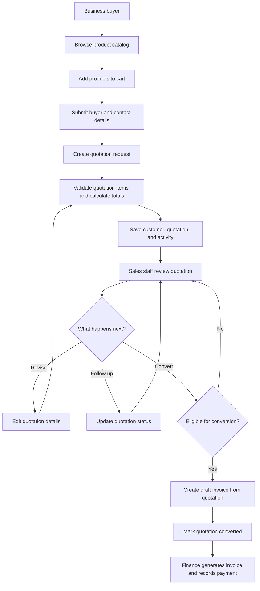
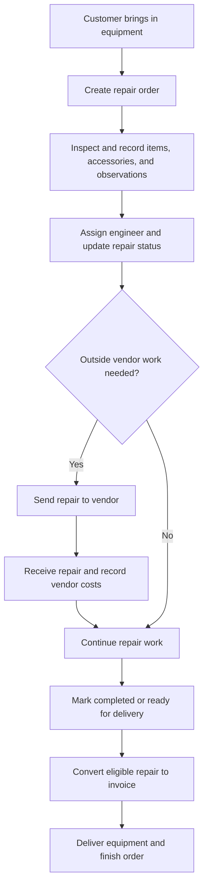
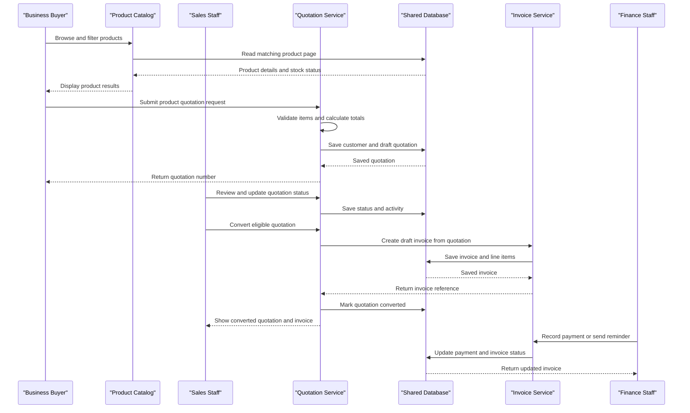

# Core Business Workflows

This application supports a B2B electronics sales and quotation process, repair-order operations, finance, and internal project/work tracking. Customers browse products and request quotations; staff manage the resulting sales, repair, invoicing, and administrative work.

## Business Module Hierarchy

The chart shows the main parent modules and the features grouped under each one in the application. Invoice handling is shared by Sales, Finance, and Repair because quotations and repair orders can both lead to invoices. Employee features here mean the existing team directory, employee dashboard, personal tasks, leaderboard, and time tracking; the code does not show a separate HR/payroll module.

```mermaid
flowchart TD
    App["Business Platform"]

    App --> Sales["Sales"]
    Sales --> SalesOverview["Sales Overview"]
    Sales --> Clients["Clients and Contacts"]
    Sales --> Catalog["Products and Product Variants"]
    Sales --> Inventory["Product Categories and Inventory"]
    Sales --> Quotations["Quotations"]
    Sales --> Orders["Orders"]

    App --> Repair["Repair Service"]
    Repair --> RepairDashboard["Repair Dashboard and Reports"]
    Repair --> RepairOrders["Repair Orders"]
    RepairOrders --> RepairList["Order List and Status Views"]
    RepairOrders --> RepairIntake["Create and Edit Repair"]
    RepairOrders --> RepairInspection["Items, Accessories, and Observations"]
    RepairOrders --> RepairAssignment["Status, Priority, and Engineer Assignment"]
    RepairOrders --> Outsourcing["Vendor Outsourcing"]
    Outsourcing --> SendVendor["Send Repair to Vendor"]
    Outsourcing --> ReceiveVendor["Receive Repair and Record Costs"]
    RepairOrders --> RepairBilling["Convert Eligible Repair to Invoice"]

    App --> Finance["Finance"]
    Finance --> FinanceOverview["Payments and Finance Overview"]
    Finance --> InvoiceManagement["Invoice Management"]
    InvoiceManagement --> InvoiceCreate["Create and Edit Invoices"]
    InvoiceManagement --> InvoicePayment["Record Payments and Balances"]
    InvoiceManagement --> InvoiceDelivery["Generate, Share, and Remind"]
    Finance --> Expenses["Expenses"]
    Finance --> FinanceReports["Revenue, Profit, Cash Flow, and Reports"]

    App --> Work["Work Management"]
    Work --> Projects["Projects"]
    Projects --> Milestones["Milestones and Timelines"]
    Projects --> Tasks["Tasks, Boards, Backlog, and Calendar"]
    Tasks --> Collaboration["Comments, Checklists, and Attachments"]
    Work --> PersonalTasks["Personal Tasks"]
    Work --> TimeTracking["Time Tracking"]
    Work --> WorkViews["Project and Task Views"]

    App --> Employee["Employee"]
    Employee --> Directory["Employee Directory"]
    Employee --> EmployeeDashboard["Employee Dashboard"]
    Employee --> MyTasks["Personal Tasks"]
    Employee --> Performance["Leaderboard and Story Points"]
    Employee --> EmployeeTime["Time Tracking"]

    App --> Admin["Administration"]
    Admin --> Access["Login, Roles, Permissions, and Account Security"]
    Admin --> UserAdmin["User Management and Audit History"]
    Admin --> CompanyAdmin["Company Settings"]
    Admin --> EmailAdmin["Company Email Settings"]
    Admin --> RepairSetup["Repair Settings and Machine Categories"]
    Admin --> VendorAdmin["Vendor Management"]

    Quotations -. "can create" .-> InvoiceManagement
    RepairBilling -. "creates" .-> InvoiceManagement
    EmployeeDashboard -. "summarizes" .-> Work
    MyTasks -. "tracked in" .-> Work
    EmployeeTime -. "logged against" .-> Tasks
```

### Sales Module Process

The Sales module supports customer and quotation management, from a buyer's product selection through quotation review and conversion to an invoice. Sales staff can also create quotations directly; invoice follow-up and payment collection are handled with Finance.

### Repair Service Process

## Domain Entities

| Entity | Service / Bounded Context | Description | Key Relationships |
|---|---|---|---|
| Company | Tenant and Company Administration | Company account that scopes users and business data. | Owns users, settings, email configuration, and tenant-scoped records. |
| User | Identity and Access | Staff account with role/permission-based access. | Belongs to a company; actions are recorded in audit history. |
| Product, Variant, Category | Product Catalog | Products offered to business buyers, organized into categories and optional variants. | Products may have images, specifications, features, reviews, and variants. |
| Customer and Customer Contact | Customer Management | Business buyer/customer and their contact people. | Customers participate in quotations, invoices, and repair orders; contacts belong to a customer. |
| Quotation and Quotation Item | Sales | Commercial offer/request with line items, pricing, taxes, charges, status, and activity history. | Belongs to a customer; can be converted to one invoice. |
| Invoice and Invoice Item | Billing and Finance | Receivable document created directly, from a quotation, or from a completed repair. | Belongs to a customer/company; records payments and can have a PDF/signature. |
| Expense | Finance | Company expense tracked for finance reporting. | Contributes to expense, profit, and cash-flow reporting. |
| Repair Order, Item, Accessory | Repair Operations | Device/equipment repair case, its work items/accessories, and service charges. | Belongs to a customer/contact and machine category; can be sent to vendors and converted to an invoice. |
| Repair Observation and Activity | Repair Operations | Technical notes and chronological record of repair/order changes. | Belongs to a repair order. |
| Repair Outsourcing and Vendor | Vendor Operations | A vendor engagement for a repair and the vendor that performs the outsourced work. | An order can have outsourcing legs; return costs roll into repair totals. |
| Project, Milestone, Task | Work Management | Internal work organized into projects, milestones, and assigned tasks. | Tasks belong to projects and may be grouped under milestones. |
| Personal Task, Comment, Checklist, Attachment, Time Log | Work Management | Personal work and supporting collaboration, checklist, file, and time-tracking records. | Comments/checklists/attachments/time logs are associated with tasks; personal tasks belong to employees. |

## Service-to-Domain Mapping

The backend is a single Spring application organized into modules, not a set of independently deployed business microservices. The modules share the application persistence layer; the configured tenant-access client is an external service integration.

| Service | Domain Context | Owned Entities | External Dependencies |
|---|---|---|---|
| Product and Category APIs | Product Catalog | Products, variants, categories, product media/details | Shared MySQL database; local file storage for supported files |
| Customer and Contact APIs | Customer Management | Customers, customer contacts | Shared MySQL database |
| Quotation API | Sales | Quotations, quotation items, activity logs, attachments | Customer and product data; invoice persistence during conversion |
| Invoice API | Billing and Finance | Invoices, invoice items, payment state, generated PDF/signature files | Customer/company data; local file storage; company email configuration for related communication |
| Repair Order API | Repair Operations | Repair orders, items, accessories, observations, activity, outsourcing legs | Customers/contacts, machine categories, vendors, products, and Invoice API |
| Finance API | Finance | Expenses and finance analytics over invoices/expenses | Invoice and expense data in the shared database |
| Vendor API | Vendor Operations | Vendors and vendor-spend summaries | Shared MySQL database |
| Work Management APIs | Internal Work Management | Projects, project membership, milestones, tasks, personal tasks, comments, checklists, attachments, history, story-point ledger, time logs | Shared persistence; frontend includes work-management service clients |
| Auth, User, Company, Email Settings APIs | Identity and Company Administration | Users, refresh tokens, audit events, company settings, per-company email settings | Configured tenant-access service; per-company SMTP; shared MySQL database |

## Primary Workflows

### Workflow 1: Browse products and request a quotation

1. A buyer browses the public product catalog, which supports paginated listing and search/filtering by category, brand, price, stock status, and sorting.
2. The buyer adds products to the cart and submits buyer/contact details as a quotation request; the UI confirms the quotation number and links to its detail page.
3. The quotation service validates that there are line items and valid quantities/prices, associates or creates the customer, calculates totals, records a creation activity, and persists the quotation.
4. Staff review and update the quotation status and can edit, duplicate, or delete it while it remains eligible.

### Workflow 2: Convert a quotation to an invoice

1. Staff progress the quotation through its business statuses (draft, sent, viewed, accepted, rejected, expired, or converted).
2. Staff may convert a quotation unless it is draft, expired, rejected, or already converted.
3. The system copies customer and line-item/pricing information into a draft invoice, records the invoice reference on the quotation, and marks the quotation converted.
4. The conversion operation is transactional in the service layer. Converted quotations cannot be edited or status-changed.

### Workflow 3: Manage an invoice and collect payment

1. Staff create an invoice directly or receive one from a quotation or repair order.
2. The invoice service validates the request and calculates monetary totals.
3. Staff generate/share the invoice, record payments, add a signature image, or send reminders where allowed.
4. Invoice lifecycle includes draft, generated, partially paid, paid, and cancelled. Payment is rejected for draft or cancelled invoices; reminders are rejected for draft or cancelled invoices.
5. Finance views invoice/revenue/expense/profit/cash-flow data and reports.

### Workflow 4: Process a repair and optional vendor outsourcing

1. Staff create a repair order for a customer/contact and machine category, then add repair items, accessories, observations, and charges.
2. Staff record status, priority, engineer assignment, and activity; the repair dashboard and list provide operational views.
3. If outside work is required, staff send the repair to an active vendor and later record its return, dates, vendor invoice reference, and costs. Returned costs are included in repair cost/profit totals.
4. A repair currently with a vendor cannot advance to delivery/completion states or be invoiced. Cancelled orders cannot change status.
5. Completed or ready-for-delivery repairs with billable work can be converted to an invoice; duplicate conversion is prevented.

### Workflow 5: Plan and track internal work

1. Employees and managers create/view projects and milestones and maintain project tasks.
2. Tasks can be assigned, updated, transferred, moved through statuses, and supported with comments, checklists, and attachments.
3. Employees manage personal tasks, log time, and view work dashboards and leaderboard information.
4. History and story-point records support visibility into work changes and progress.

### Workflow 6: Administer company access and operating settings

1. Users authenticate and obtain/refresh a session; account security supports password changes and account lockout controls.
2. Authorized administrators manage users, roles/access, unlock/reset-password operations, and user audit history.
3. Company settings and company-specific email settings are maintained separately; email setup includes verification and test-send actions.
4. Tenant context and authorization scope access to company data.

### Other Workflows

- Staff maintain products, variants, product categories, machine categories, customers, contacts, and vendors.
- Finance staff maintain expenses and review finance dashboards/reports, including vendor/customer/invoice reporting views.
- Internal provisioning creates company/root access through a restricted internal API.

## Cross-Service Data Flows

There is no API gateway aggregation layer evident in the application. The business modules interact inside the same backend and share the database. Quotation conversion creates an invoice and updates the quotation in the same workflow. Repair invoicing delegates invoice creation to the invoice service; repair/vendor costs feed repair totals and profit calculations. Finance analytics reads invoices and expenses to build reporting data.

The application is tenant-scoped. `application.properties` configures a tenant access-control service at `http://localhost:8082`; company SMTP is configured per company rather than globally. The public product catalog reads product/category/variant data and exposes stock status for filtering and display.

## Business Workflow Sequence

<!-- mermaid-checked: every participant uses `participant Id as "Label"`, no \n in aliases/messages/notes, every alt/opt/loop closed by end, no `:` inside any alias -->

## Business Rules & Decision Logic

- **Quotation validation and totals:** A quotation must contain at least one item; quantities must be positive and unit prices valid. Totals include discounts, tax, other charges, shipping, packing, and optional round-off. Quotation status and activity history are retained.
- **Quotation-to-invoice eligibility:** Draft, expired, rejected, and already-converted quotations cannot be converted. Conversion creates a draft invoice and marks the quotation converted; a converted quotation cannot be edited or status-changed.
- **Inventory rule:** Product and variant stock quantities/statuses are modeled, and product listing can filter by stock status. The repository's stated business rule is to validate stock when creating a quotation and decrement stock only at quotation-to-invoice conversion. In the traced quotation creation/conversion service code, an explicit availability check and stock decrement were not found; treat this as an implementation gap to verify.
- **Invoice lifecycle and payments:** Allowed transitions are constrained. Payments cannot be recorded against draft/cancelled invoices; payment cannot exceed the invoice total. Invoice totals and balance due are calculated using monetary values.
- **Repair lifecycle:** Cancelled repairs are terminal. Completed repairs can move only to delivered. A repair at a vendor must be received back before moving to ready/delivered/completed or being invoiced. Only completed or ready-for-delivery repairs can be converted; conversion is one-time and requires billable work.
- **Outsourcing:** A repair cannot be sent to an inactive vendor, sent again while already at a vendor, or sent after invoicing/completion/delivery/cancellation. Return dates cannot precede send dates; returned vendor/transport/additional costs contribute to repair totals.
- **Work management:** Project, milestone, task, and personal-task operations are permission-controlled; task history, comments/checklists/attachments, and time logs support operational collaboration.
- **Identity and tenant boundaries:** Authentication, roles/permissions, account lockout, tenant scoping, audit logging, and company-specific email settings govern staff access and administration.
- **Transactions and error handling:** Quotation, invoice, and repair write workflows use transactional service methods. Business validation failures are raised as application exceptions and translated through the shared API error handling layer.
