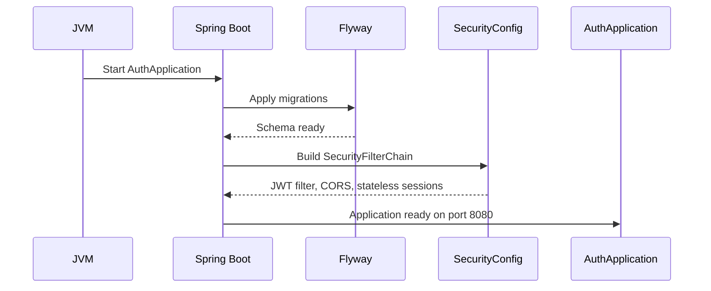
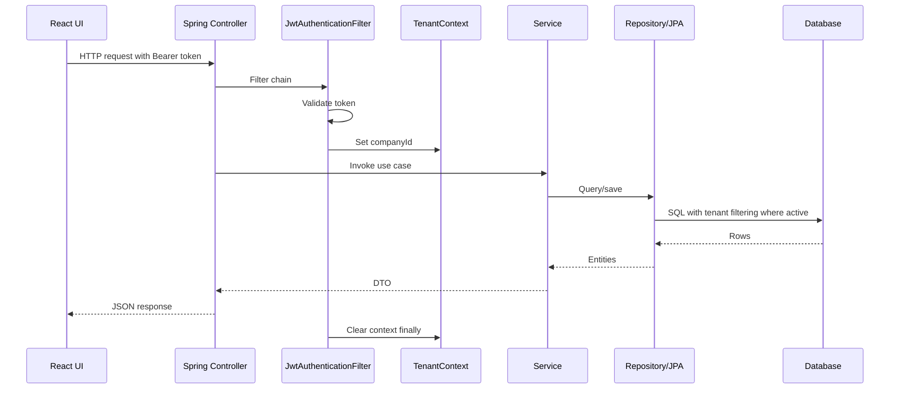
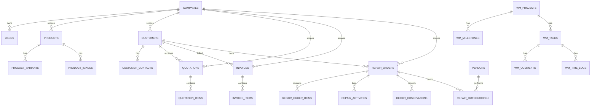
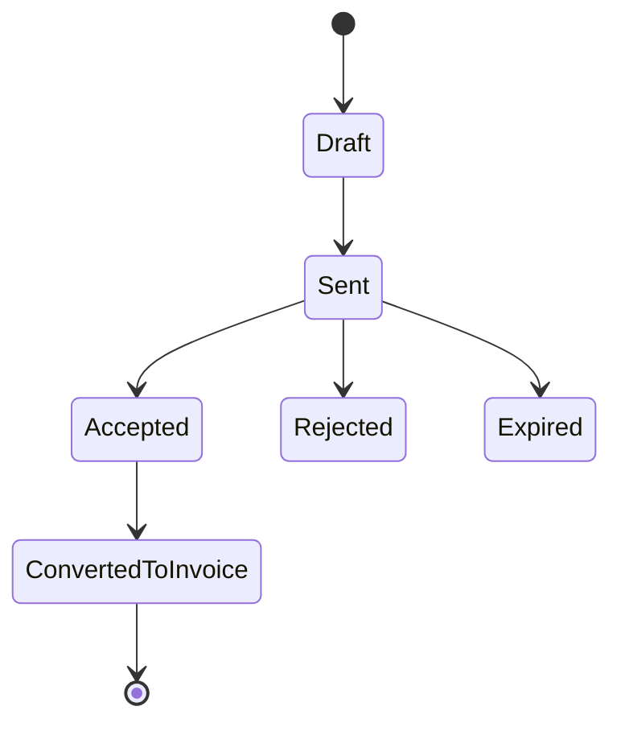
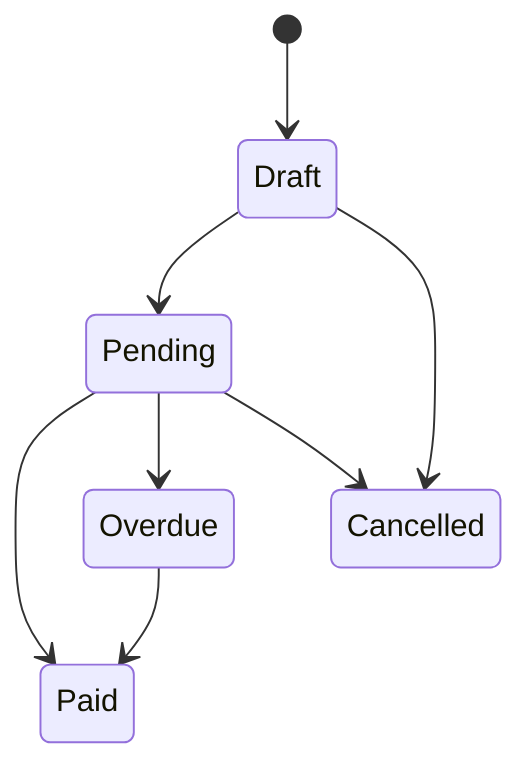
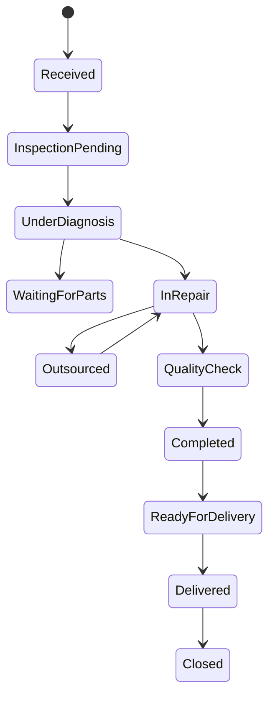
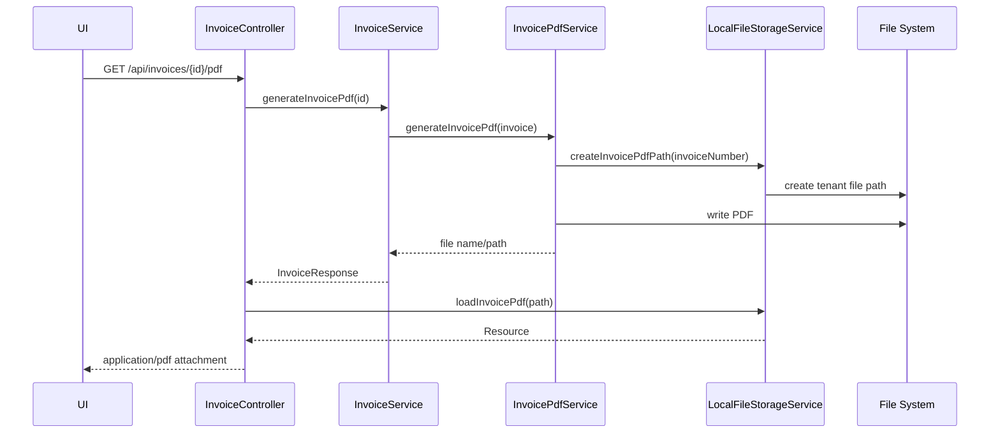
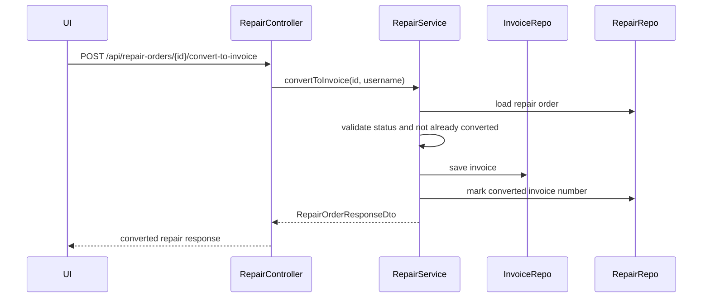
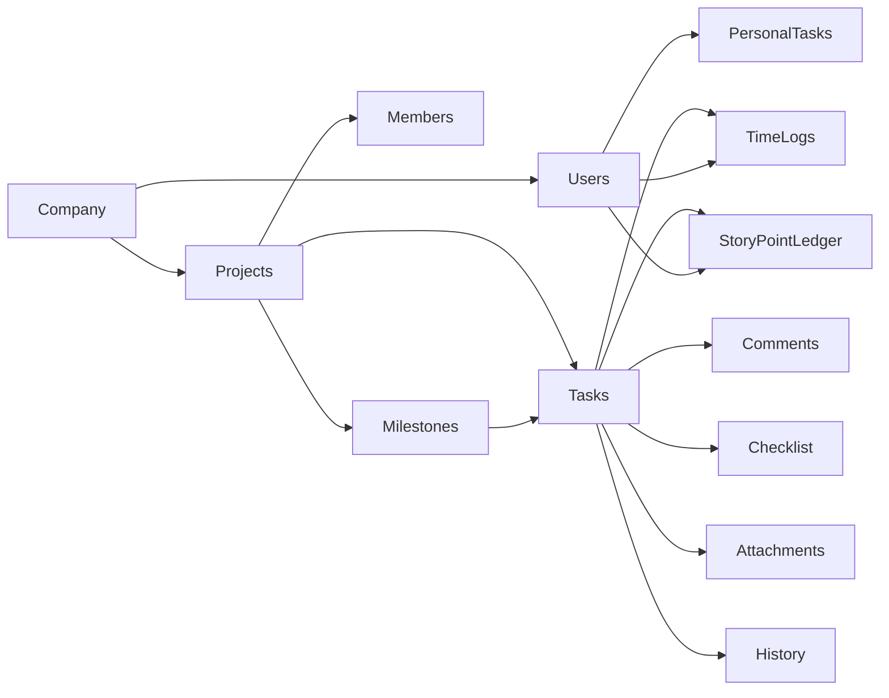
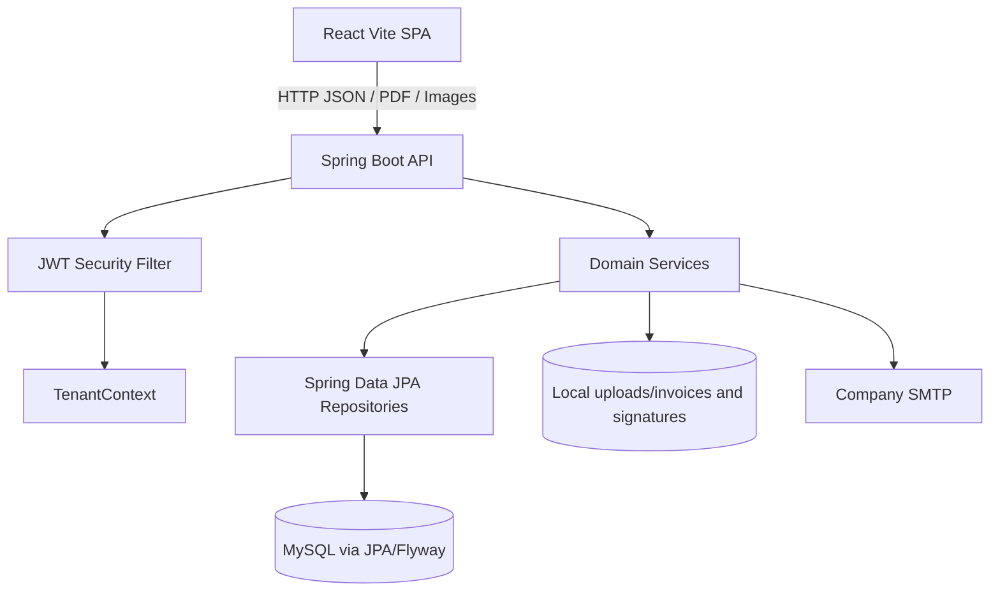

# Product Audit and Knowledge Base

Audit date: 2026-08-04

Scope reviewed: React frontend under `src/app`, Spring Boot backend under `backend/src/main/java`, Flyway migrations under `backend/src/main/resources/db/migration`, project docs, routes, services, controllers, entities, repositories, tests, and configuration.

Important scope finding: the attached prompt describes an industrial backup, restore, cloning, disk imaging, and disaster recovery product. This repository does not contain that product. The current repository is a multi-tenant e-commerce, repair-order, quotation, invoice, finance, company administration, and work-management application. No full disk backup, partition backup, restore, cloning, network discovery, bootable recovery environment, or disk/partition engine code was found.

## 1. Executive Summary

The product in this repository is a React + Spring Boot business management application originally scaffolded from an e-commerce UI and extended into an ERP-like system for industrial hardware sales and repair operations.

Observed capabilities:

- Public product catalog and product detail pages.
- Cart, checkout, and customer quotation submission.
- Admin login and company registration.
- Multi-company data model using `companies`, `users.company_id`, tenant-scoped tables, Hibernate filters, JWT `companyId` claims, and tenant-aware file storage.
- Product, category, and variant administration.
- Customer/client and customer-contact management.
- Sales quotations with duplication, status changes, and invoice conversion.
- Invoice lifecycle with draft/pending/paid/overdue/cancelled states, dashboard metrics, PDF generation, signature/stamp upload, payment recording, email sharing, and reminders.
- Repair-order lifecycle for industrial machines, including intake, observations, status tracking, outsourcing to vendors, vendor receiving, financial fields, stats, activities, and invoice conversion.
- Machine categories and vendor management.
- Company profile, bank, tax, and email SMTP settings.
- User management for company admins.
- Early work-management module with projects, milestones, tasks, personal tasks, comments, checklist, attachments, time logs, history, and leaderboard schema. The frontend still primarily uses a mock service layer for this module.

Strategic readiness:

- Multi-company support exists, but tenant isolation is incomplete and inconsistent across public endpoints, repositories, frontend service calls, and generated files.
- Licensing, billing plans, feature entitlements, environment provisioning, revocation, master support access, and full audit logging are not implemented.
- The codebase has meaningful foundations for a future management platform, especially company registration, company status, admin roles, tenant columns, and invoice billing primitives. It is not yet ready to become a centralized licensing/billing platform without architectural hardening.

Highest-risk findings:

- The actual product does not match the industrial backup product described in the prompt.
- JWT secret and database credentials are hardcoded in `backend/src/main/resources/application.properties`.
- Frontend expects a refresh token and `/api/auth/refresh`, but backend does not expose refresh-token support.
- Several endpoints that mutate business data are public or weakly protected by Spring Security rules, including quotation creation and public client routes.
- Tenant filtering relies on AOP around `com.ecommerce.auth.repository.*`; repositories under `com.ecommerce.auth.work.repository` are not covered by that aspect pattern.
- Some frontend modules are still mock-backed while corresponding backend modules exist, so UI behavior and backend behavior can diverge.
- Several service and UI files are very large, especially `InvoicePdfService.java`, `InvoiceServiceImpl.java`, `RepairOrderServiceImpl.java`, `finance-invoice-create.tsx`, and `repair-order-create.tsx`.

## 2. Product Documentation

### Product Overview

This product helps companies manage industrial product sales and repair workflows. It combines a public product catalog with an authenticated admin panel for inventory, categories, variants, clients, quotations, repair orders, invoices, company settings, email settings, users, finance dashboards, and work-management screens.

Primary users:

- Public visitors or customers browsing products and requesting quotations.
- Company admins managing products, sales, finance, repairs, settings, and users.
- Sales/admin staff preparing quotations and invoices.
- Repair teams tracking machine repair intake, diagnosis, outsourcing, completion, and delivery.
- Managers, HR, and employees in the work-management module.
- Platform super-admins for company activation/suspension/deactivation.

Likely customers:

- Industrial equipment sellers and repair/service providers.
- Companies that need repair-order tracking, sales quotations, GST-aware invoices, vendor outsourcing, and company-scoped user access.

Industries implied by code and UI:

- Industrial machinery repair.
- Industrial hardware and electronics service.
- B2B equipment sales and services.

### Functional Modules

#### Public Catalog

Purpose: display product listings and product details for public users.

Key files:

- `src/app/pages/products.tsx`
- `src/app/pages/product-details.tsx`
- `src/app/components/product-card.tsx`
- `src/app/services/productService.ts`
- `backend/src/main/java/com/ecommerce/auth/controller/ProductController.java`
- `backend/src/main/java/com/ecommerce/auth/service/ProductService.java`

Flow:

1. User visits `/` or `/products`.
2. Frontend calls product listing APIs.
3. User filters/searches/sorts catalog and opens `/products/:id`.
4. Backend returns paged listing or detailed product data.
5. Product images are served from database-backed image records via `/api/products/images/{imageId}`.

Inputs: search query, category, brand, min/max price, stock status, sort, pagination.

Outputs: product cards, product details, product images.

Limitations:

- Public product endpoints are permit-all; tenant context is absent for unauthenticated calls, so product visibility across companies needs explicit design.
- Product update is not implemented on the backend controller; frontend contains a TODO for update.
- Legacy `GET /api/products/products/list.json` coexists with modern paged listing.

#### Cart and Checkout

Purpose: allow public users to assemble products and submit a quotation request.

Key files:

- `src/app/context/cart-context.tsx`
- `src/app/pages/cart.tsx`
- `src/app/pages/checkout.tsx`
- `src/app/pages/quotation-confirmation.tsx`
- `backend/src/main/java/com/ecommerce/auth/controller/QuotationController.java`

Flow:

1. User adds products to local cart.
2. Cart persists in browser `localStorage`.
3. Checkout collects customer/company/contact details and item notes.
4. Checkout posts a quotation to `/api/quotations`.
5. Confirmation page reads quotation by ID.

Inputs: cart items, customer fields, GST/address details, notes.

Outputs: quotation record and confirmation view.

Limitations:

- Cart is local browser state only.
- Quotation creation is public.
- Public quotation retrieval by ID is permitted.

#### Authentication and Company Registration

Purpose: authenticate admin users and create company tenants.

Key files:

- `src/app/services/authService.ts`
- `src/app/context/AuthContext.tsx`
- `src/app/components/ProtectedRoute.tsx`
- `src/app/pages/admin-login.tsx`
- `src/app/pages/company-register.tsx`
- `backend/src/main/java/com/ecommerce/auth/controller/AuthController.java`
- `backend/src/main/java/com/ecommerce/auth/service/CompanyService.java`
- `backend/src/main/java/com/ecommerce/auth/security/JwtTokenProvider.java`
- `backend/src/main/java/com/ecommerce/auth/security/JwtAuthenticationFilter.java`
- `backend/src/main/java/com/ecommerce/auth/config/SecurityConfig.java`

Flow:

1. User registers a company at `/register`.
2. Backend creates a `Company` and root `ROLE_ADMIN` user.
3. Backend issues JWT containing `sub`, `companyId`, `role`, issued-at, and expiration.
4. Frontend stores token and user information in `localStorage`.
5. Authenticated requests attach `Authorization: Bearer <token>`.
6. JWT filter validates token, loads user, sets Spring Security authentication, and sets `TenantContext.currentCompanyId`.

Inputs: login username/password or registration details.

Outputs: JWT, company/user details, local auth state.

Limitations:

- Frontend expects a `refreshToken` and calls `/api/auth/refresh`, but backend does not implement refresh tokens.
- Logout is stateless and only clears frontend state.
- Company status is not checked during login, so suspended/deactivated companies may still authenticate unless handled elsewhere.
- JWT secret is hardcoded in properties.
- Tokens are stored in `localStorage`, increasing exposure to XSS.

#### Tenant and Company Administration

Purpose: scope data by company and allow platform-level company state management.

Key files:

- `backend/src/main/java/com/ecommerce/auth/entity/Company.java`
- `backend/src/main/java/com/ecommerce/auth/entity/TenantAware.java`
- `backend/src/main/java/com/ecommerce/auth/entity/TenantEntityListener.java`
- `backend/src/main/java/com/ecommerce/auth/security/TenantContext.java`
- `backend/src/main/java/com/ecommerce/auth/security/TenantFilterAspect.java`
- `backend/src/main/java/com/ecommerce/auth/repository/TenantAwareJpaRepository.java`
- `backend/src/main/java/com/ecommerce/auth/controller/PlatformAdminController.java`

Flow:

1. JWT supplies company ID.
2. `JwtAuthenticationFilter` sets `TenantContext`.
3. `TenantEntityListener` auto-fills `companyId` on new tenant-aware records.
4. Hibernate `tenantFilter` filters entities with `company_id`.
5. Platform super-admin can list, suspend, activate, and deactivate companies.

Inputs: JWT `companyId`, company admin requests, platform admin requests.

Outputs: company-scoped data and company status changes.

Limitations:

- Aspect pointcut only targets `com.ecommerce.auth.repository.*.*(..)`, not `com.ecommerce.auth.work.repository.*`.
- If `TenantContext` is null, `TenantAwareJpaRepository` returns records without tenant check.
- Public endpoints may execute without tenant context.
- No environment provisioning, license binding, entitlements, billing plan, or audit trail for company status changes.

#### Admin Product, Category, and Variant Management

Purpose: manage product catalog structure and sellable variants.

Key files:

- `src/app/pages/admin-products.tsx`
- `src/app/pages/admin-categories.tsx`
- `src/app/components/product-form-dialog.tsx`
- `src/app/components/create-category-dialog.tsx`
- `src/app/components/variant-form-dialog.tsx`
- `src/app/services/productService.ts`
- `src/app/services/categoryService.ts`
- `src/app/services/variantService.ts`
- `backend/src/main/java/com/ecommerce/auth/controller/ProductController.java`
- `backend/src/main/java/com/ecommerce/auth/controller/CategoryController.java`
- `backend/src/main/java/com/ecommerce/auth/controller/ProductVariantController.java`

Flow:

1. Admin opens product or category screens under `/admin`.
2. Frontend lists products/categories/variants.
3. Admin creates products with multipart form data and optional images.
4. Admin creates/updates/deletes categories and variants.

Inputs: product metadata, pricing, tax, stock, images, category hierarchy, variant attributes.

Outputs: product records, categories, variants, product images.

Limitations:

- Product update path is stubbed in frontend.
- Some product/category/variant service methods manually read token from `localStorage` instead of using central `authService`.
- Category and variant GET endpoints are public.

#### Client and Customer Contact Management

Purpose: maintain client/customer master data and customer contacts.

Key files:

- `src/app/pages/sales-clients.tsx`
- `src/app/components/create-client-dialog.tsx`
- `src/app/services/clientService.ts`
- `src/app/services/customerContactService.ts`
- `backend/src/main/java/com/ecommerce/auth/controller/CustomerController.java`
- `backend/src/main/java/com/ecommerce/auth/controller/CustomerContactController.java`
- `backend/src/main/java/com/ecommerce/auth/service/impl/CustomerContactServiceImpl.java`

Flow:

1. Admin lists/searches clients.
2. Admin creates/updates/deletes client records.
3. Customer contacts can be created, updated, marked primary, deactivated, and listed per customer.

Inputs: customer name, company, email, phone, address, GST, contacts.

Outputs: customer and customer-contact data used by quotations, invoices, and repair orders.

Limitations:

- `/api/clients/**` is permit-all in Spring Security.
- Contact endpoints require authentication through `/api/**`, but endpoint-level role checks are not visible.

#### Sales Quotations

Purpose: create, manage, duplicate, status-track, and convert sales quotations.

Key files:

- `src/app/pages/sales-quotations.tsx`
- `src/app/pages/quotation-create.tsx`
- `src/app/pages/quotation-view.tsx`
- `src/app/services/quotationService.ts`
- `backend/src/main/java/com/ecommerce/auth/controller/QuotationController.java`
- `backend/src/main/java/com/ecommerce/auth/service/impl/QuotationServiceImpl.java`
- `backend/src/main/java/com/ecommerce/auth/entity/Quotation.java`
- `backend/src/main/java/com/ecommerce/auth/entity/QuotationItem.java`

Flow:

1. Quotation is created from checkout or admin UI.
2. Backend generates quotation number.
3. Items, customer, commercial terms, activity logs, and statuses are stored.
4. Quotation can be updated, duplicated, deleted, status-changed, or converted to invoice.

Inputs: customer, billing/shipping details, product/service items, taxes, terms, references, status.

Outputs: quotation records and optional converted invoice.

Limitations:

- Creation and GET endpoints are public.
- Quotation conversion has business rules, but authorization is broad due public/permit-all mappings.
- Number generation is application-side and retries for uniqueness; concurrent load needs stronger guarantees.

#### Invoice and Finance

Purpose: manage invoices, payments, dashboard metrics, PDF generation, signature/stamp images, sharing, and reminders.

Key files:

- `src/app/pages/finance-invoices.tsx`
- `src/app/pages/finance-invoice-create.tsx`
- `src/app/pages/finance-invoice-view.tsx`
- `src/app/pages/finance-overview.tsx`
- `src/app/pages/finance-revenue.tsx`
- `src/app/pages/finance-expenses.tsx`
- `src/app/pages/finance-profit.tsx`
- `src/app/pages/finance-cashflow.tsx`
- `src/app/pages/finance-reports.tsx`
- `src/app/services/financeService.ts`
- `backend/src/main/java/com/ecommerce/auth/controller/InvoiceController.java`
- `backend/src/main/java/com/ecommerce/auth/service/impl/InvoiceServiceImpl.java`
- `backend/src/main/java/com/ecommerce/auth/service/InvoicePdfService.java`
- `backend/src/main/java/com/ecommerce/auth/service/impl/DocumentShareServiceImpl.java`
- `backend/src/main/java/com/ecommerce/auth/service/impl/LocalFileStorageService.java`

Flow:

1. Admin creates invoice or converts quotation/repair order to invoice.
2. Invoice service validates status transitions and amounts.
3. Invoice items and customer are persisted.
4. PDF can be generated and stored under tenant-specific upload directories.
5. Signature/stamp image can be uploaded for invoice PDF rendering.
6. Payments update amount paid/due and status.
7. Invoice can be shared by email using company SMTP settings.
8. Dashboard endpoints provide invoice metrics and trends.

Inputs: invoice customer, items, tax fields, dates, amounts, payment details, signature file, share/reminder recipient details.

Outputs: invoice records, PDF files, dashboard response, reminder/share responses.

Limitations:

- Finance overview/revenue/expenses/profit/cashflow frontend functions still return mock data.
- There are no backend `/api/finance/*` endpoints for most finance dashboards.
- `InvoicePdfService` is a very large rendering class.
- File storage is local disk, not object storage.
- Some invoice download endpoints identify files by file name, relying on sanitization and tenant directory checks.

#### Repair Orders and Outsourcing

Purpose: track industrial equipment repairs from intake to delivery, including observations, parts/items, outsourcing, status, stats, and invoice conversion.

Key files:

- `src/app/pages/repair-orders-dashboard.tsx`
- `src/app/pages/repair-orders-list.tsx`
- `src/app/pages/repair-order-create.tsx`
- `src/app/pages/repair-order-view.tsx`
- `src/app/pages/repair-order-edit.tsx`
- `src/app/pages/repair-outsourcing.tsx`
- `src/app/services/repairService.ts`
- `backend/src/main/java/com/ecommerce/auth/controller/RepairOrderController.java`
- `backend/src/main/java/com/ecommerce/auth/service/impl/RepairOrderServiceImpl.java`
- `backend/src/main/java/com/ecommerce/auth/entity/RepairOrder.java`
- `backend/src/main/java/com/ecommerce/auth/entity/RepairOutsourcing.java`
- `backend/src/main/java/com/ecommerce/auth/entity/RepairActivity.java`
- `backend/src/main/java/com/ecommerce/auth/entity/RepairObservation.java`

Flow:

1. Admin creates repair order with customer/contact, machine, complaint, category, accessories, priority, and items.
2. Backend generates repair number and stores activities.
3. Admin searches/list filters by status, priority, customer, contact, machine fields, product, owning company, outsourcing status, and date range.
4. Admin updates details/status, adds observations, sends to vendor, receives from vendor, and converts eligible repairs to invoices.
5. Dashboard displays stats and recent activity.

Inputs: repair intake fields, machine/category, customer/contact, repair status, observations, outsourcing requests, vendor receive details.

Outputs: repair records, summaries, stats, activities, invoices.

Limitations:

- `src/app/services/repairOrderService.ts` remains entirely mock-backed and points to `https://your-backend-api.com/api`; the newer `repairService.ts` is the real API-backed service.
- Repair authorization is mostly route-level authenticated, not fine-grained role or workflow authorization.
- Number generation is application-side.
- Soft delete exists, but broader audit and immutable history guarantees are partial.

#### Machine Categories and Vendors

Purpose: maintain repair classification and outsourcing vendor master data.

Key files:

- `src/app/services/machineCategoryService.ts`
- `src/app/services/vendorService.ts`
- `backend/src/main/java/com/ecommerce/auth/controller/MachineCategoryController.java`
- `backend/src/main/java/com/ecommerce/auth/controller/VendorController.java`
- `backend/src/main/java/com/ecommerce/auth/service/impl/MachineCategoryServiceImpl.java`
- `backend/src/main/java/com/ecommerce/auth/service/impl/VendorServiceImpl.java`

Flow:

1. Admin creates/updates active machine categories and vendors.
2. Repair orders reference machine categories.
3. Outsourcing legs reference vendors.
4. Vendor spend summary is derived from outsourcing records.

Inputs: category name/code, vendor details, active flags.

Outputs: pageable lists, active/inactive state, vendor spend summaries.

Limitations:

- No dedicated frontend screen for machine categories was identified beyond use inside repair forms.
- No vendor credential/compliance or document management exists.

#### Company Settings and Email Settings

Purpose: configure company tax/bank profile and SMTP sender settings for invoice sharing/reminders.

Key files:

- `src/app/pages/admin-company-settings.tsx`
- `src/app/pages/admin-email-settings.tsx`
- `src/app/services/companySettingsService.ts`
- `src/app/services/emailSettingsService.ts`
- `backend/src/main/java/com/ecommerce/auth/controller/CompanySettingsController.java`
- `backend/src/main/java/com/ecommerce/auth/controller/CompanyEmailSettingsController.java`
- `backend/src/main/java/com/ecommerce/auth/service/CompanyService.java`
- `backend/src/main/java/com/ecommerce/auth/service/impl/CompanyEmailSettingsServiceImpl.java`
- `backend/src/main/java/com/ecommerce/auth/service/impl/EmailServiceImpl.java`

Flow:

1. Admin edits company address, GST/PAN, state, bank account, IFSC, UPI, etc.
2. Admin saves SMTP provider/host/port/email/password/from-name/TLS settings.
3. Backend sends OTP to configured email and marks settings verified after OTP validation.
4. Verified settings are used for test email, invoice sharing, and reminders.

Inputs: company profile, SMTP settings, OTP, test recipient.

Outputs: company info for invoices and verified email sender.

Limitations:

- SMTP password is stored in the database without evidence of encryption.
- OTP has no explicit attempt/rate-limit control in the reviewed service.
- Sender cache is in-memory per app instance.

#### User Management

Purpose: company admins create, update, disable, and list users.

Key files:

- `src/app/pages/admin-users.tsx`
- `src/app/services/userService.ts`
- `backend/src/main/java/com/ecommerce/auth/controller/UserController.java`
- `backend/src/main/java/com/ecommerce/auth/service/UserService.java`

Flow:

1. Admin lists users for current tenant.
2. Admin creates users with `ROLE_ADMIN` or `ROLE_USER`.
3. Admin updates fields and role.
4. Delete operation disables user rather than hard deleting.

Inputs: username, email, password, role.

Outputs: pageable user list and user records.

Limitations:

- Only `ROLE_ADMIN` and `ROLE_USER` are allowed by service; `ROLE_SUPER_ADMIN` path is not integrated with company user management.
- Work-management role is a separate `work_role` field.

#### Work Management

Purpose: manage internal projects, milestones, task boards, backlog, calendar, personal tasks, employee dashboard, leaderboard, comments, checklist, attachments, history, story points, and time logs.

Key files:

- `src/app/features/work-done/screens/*`
- `src/app/features/work-done/components/*`
- `src/app/features/work-done/services/*`
- `src/app/features/work-done/mock/*`
- `backend/src/main/java/com/ecommerce/auth/work/*`
- `backend/src/main/resources/db/migration/V5__work_management_module.sql`

Flow:

1. Admin opens `/admin/work-done`.
2. Router loads project list, project shell, overview, timeline, Kanban board, backlog, calendar, dashboard, personal tasks, or leaderboard screens.
3. Frontend services currently use mock store and simulated latency for most module operations.
4. Backend exposes project and employee endpoints and has entities/repositories/schema for full module expansion.

Inputs: projects, milestones, tasks, labels, comments, checklist, attachments, time logs, roles.

Outputs: project/task views, progress, leaderboard, calendar, employee dashboards.

Limitations:

- Backend currently exposes only `/api/wm/projects` and `/api/wm/employees`; many task/milestone/comment/checklist/attachment/time-log APIs are not yet exposed.
- Frontend mock layer is not wired to backend for most operations.
- Work repository tenant filtering may be missed by current `TenantFilterAspect`.

### Missing Industrial Backup Modules

The following prompt-requested modules were not found in this repository:

- Full disk backup.
- Partition backup.
- Restore.
- Disk cloning.
- Image creation, compression, verification, checksums, resume capability.
- Disk/partition information.
- Device discovery over network.
- Remote backup/restore.
- Bootable recovery environment.
- Industrial hardware backup agent/service.
- Backup scheduler.
- Backup engine progress tracking or error recovery.
- Backup network communication protocol.

Conclusion: either the wrong repository was supplied for the prompt, or the business context is for a future/different product.

## 3. Screen Documentation

### Public Screens

| Route | Screen | Purpose | Main actions | APIs |
| --- | --- | --- | --- | --- |
| `/` | Products | Public catalog landing/listing | Search, filter, sort, paginate, view details | `GET /api/products` |
| `/products` | Products | Same as index | Search/filter/sort/paginate | `GET /api/products` |
| `/products/:id` | ProductDetails | Product detail | View images/specs/variants, add to cart | `GET /api/products/{id}`, `GET /api/variants/product/{productId}` |
| `/cart` | Cart | Review local cart | Change quantities, remove items, checkout | Local state |
| `/checkout` | Checkout | Submit quote request | Enter customer info, submit quotation | `POST /api/quotations` |
| `/quotation/:id` | QuotationConfirmation | Show submitted quotation | Review quotation details | `GET /api/quotations/{id}` |
| `/register` | CompanyRegister | Register company tenant | Create company/admin account | `POST /api/auth/register` |
| `/admin/login` | AdminLogin | Authenticate admin user | Login | `POST /api/auth/login` |

### Admin Screens

All `/admin/*` routes are wrapped in `ProtectedRoute` on the frontend. Backend authorization varies by endpoint.

| Route | Screen | Purpose | Main actions | APIs |
| --- | --- | --- | --- | --- |
| `/admin` | AdminDashboard | Admin landing/dashboard | Navigate modules | Mixed/local |
| `/admin/products` | AdminProducts | Product management | Create/delete/list products, variants | Product/category/variant APIs |
| `/admin/categories` | AdminCategories | Category hierarchy | Create/update/delete categories | Category APIs |
| `/admin/sales/overview` | SalesOverview | Sales dashboard | Review sales metrics | Mostly local/mock |
| `/admin/clients` | SalesClients | Client management | CRUD clients, contacts | Client/contact APIs |
| `/admin/quotations` | SalesQuotations | Quotation list | Search, filter, duplicate, status, convert | Quotation APIs |
| `/admin/quotations/create` | QuotationCreate | Create quotation | Build quotation | `POST /api/quotations` |
| `/admin/quotations/:id` | QuotationView | View quotation | Status, duplicate, convert | Quotation APIs |
| `/admin/quotations/:id/edit` | QuotationCreate | Edit quotation | Update quotation | `PUT /api/quotations/{id}` |
| `/admin/orders` | AdminOrders | Placeholder order page | None significant | None |
| `/admin/users` | AdminUsers | Company users | Create/update/disable/list users | User APIs |
| `/admin/company-settings` | AdminCompanySettings | Company invoice profile | Edit tax/bank/address info | Company settings APIs |
| `/admin/email-settings` | AdminEmailSettings | SMTP setup | Save, OTP verify, test email | Company email APIs |
| `/admin/settings` | AdminSettings | Placeholder settings page | None significant | None |
| `/admin/finance/overview` | FinanceOverview | Finance KPI dashboard | View metrics/charts | Mock finance service |
| `/admin/finance/revenue` | FinanceRevenue | Revenue analytics | View charts/filters | Mock finance service |
| `/admin/finance/expenses` | FinanceExpenses | Expense tracking | Add/edit/delete mock expenses | Mock finance service |
| `/admin/finance/profit` | FinanceProfit | Profit analytics | View profitability | Mock finance service |
| `/admin/finance/invoices` | FinanceInvoices | Invoice management | Search, dashboard, share, reminders, delete | Invoice APIs |
| `/admin/finance/invoices/create` | FinanceInvoiceCreate | Create invoice | Save/generate invoice, upload signature | Invoice APIs |
| `/admin/finance/invoices/:id/edit` | FinanceInvoiceCreate | Edit invoice | Update/generate invoice | Invoice APIs |
| `/admin/finance/invoices/:id` | FinanceInvoiceView | View invoice | Download PDF, payment/share/reminder | Invoice APIs |
| `/admin/finance/cashflow` | FinanceCashFlow | Cash flow dashboard | View mock cashflow | Mock finance service |
| `/admin/finance/reports` | FinanceReports | Reports | Console-log report/export actions | Mock/TODO |
| `/admin/finance/outsourcing` | Redirect | Legacy finance outsourcing route | Redirect to repair outsourcing | None |
| `/admin/repair-orders` | RepairOrdersDashboard | Repair dashboard | View KPIs/activities | Repair stats/activity APIs |
| `/admin/repair-orders/list` | RepairOrdersList | Repair list | Search/filter/view/edit | Repair search API |
| `/admin/repair-orders/create` | RepairOrderCreate | Repair intake | Create repair order | Repair, clients, contacts, categories APIs |
| `/admin/repair-orders/:id` | RepairOrderView | Repair detail | Review details/status/history | Repair get API |
| `/admin/repair-orders/:id/edit` | RepairOrderEdit | Edit repair | Update, add observation, status, outsource, receive | Repair APIs |
| `/admin/repair-orders/outsourcing` | RepairOutsourcing | Outsourcing dashboard | Vendor spend and outsourcing filters | Repair/vendor APIs |
| `/admin/work-done` | WorkDoneLayout | Work module shell | Navigate work screens | Mock/backend mixed |
| `/admin/work-done/projects` | ProjectsListPage | Project list | List/create projects | Mock services; backend project API exists |
| `/admin/work-done/projects/:projectId/overview` | ProjectOverviewPage | Project overview | View progress/members/milestones | Mock services |
| `/admin/work-done/projects/:projectId/timeline` | MilestoneTimelinePage | Milestone timeline | View timeline | Mock services |
| `/admin/work-done/projects/:projectId/board` | KanbanBoardPage | Kanban board | Move tasks, open drawer | Mock services |
| `/admin/work-done/projects/:projectId/backlog` | BacklogBoardPage | Backlog | Move tasks to milestones | Mock services |
| `/admin/work-done/projects/:projectId/calendar` | TeamCalendarPage | Team calendar | View time logs | Mock services |
| `/admin/work-done/dashboard` | EmployeeDashboardPage | Employee dashboard | View assigned/completed/overdue tasks | Mock services |
| `/admin/work-done/personal` | PersonalTasksPage | Personal tasks | Create/complete own tasks | Mock services |
| `/admin/work-done/leaderboard` | LeaderboardPage | Story point ranking | Switch windows | Mock services |

## 4. API Documentation

### Authentication and Company

| Method | Path | Purpose | Request | Response | Auth |
| --- | --- | --- | --- | --- | --- |
| POST | `/api/auth/login` | Login user and issue JWT | `LoginRequest` | `LoginResponse` | Public |
| POST | `/api/auth/register` | Register company and root admin | `CompanyRegistrationRequest` | `CompanyRegistrationResponse` | Public |
| POST | `/api/auth/logout` | Clear server security context for request | None | Message | Authenticated by `/api/**` rule |
| GET | `/api/auth/validate` | Validate current token | Bearer token | Message | Authenticated |
| GET | `/api/auth/me` | Current user/company profile | Bearer token | `LoginResponse` without token | Authenticated |
| GET | `/api/company/settings` | Get tenant company settings | None | `InvoiceCompanyInfoResponse` | Authenticated |
| PUT | `/api/company/settings` | Update tenant company settings | `CompanySettingsRequest` | `InvoiceCompanyInfoResponse` | `ROLE_ADMIN` method preauth |
| GET | `/api/admin/companies` | List companies | None | `List<CompanyResponse>` | `ROLE_SUPER_ADMIN` |
| GET | `/api/admin/companies/{id}` | Get company | Path ID | `CompanyResponse` | `ROLE_SUPER_ADMIN` |
| PATCH | `/api/admin/companies/{id}/suspend` | Suspend company | Path ID | `CompanyResponse` | `ROLE_SUPER_ADMIN` |
| PATCH | `/api/admin/companies/{id}/activate` | Activate company | Path ID | `CompanyResponse` | `ROLE_SUPER_ADMIN` |
| PATCH | `/api/admin/companies/{id}/deactivate` | Deactivate company | Path ID | `CompanyResponse` | `ROLE_SUPER_ADMIN` |

### Email Settings

| Method | Path | Purpose | Request | Response | Auth |
| --- | --- | --- | --- | --- | --- |
| GET | `/api/company/email-settings` | Read tenant SMTP settings | None | `EmailSettingsResponse` | `ROLE_ADMIN` |
| PUT | `/api/company/email-settings` | Save SMTP settings | `EmailSettingsRequest` | `EmailSettingsResponse` | `ROLE_ADMIN` |
| POST | `/api/company/email-settings/send-otp` | Send verification OTP | None | Message | `ROLE_ADMIN` |
| POST | `/api/company/email-settings/verify-otp` | Verify OTP | `VerifyEmailOtpRequest` | `EmailSettingsResponse` | `ROLE_ADMIN` |
| POST | `/api/company/email-settings/test` | Send test email | `TestEmailRequest` | Message | `ROLE_ADMIN` |

### Products, Categories, Variants

| Method | Path | Purpose | Request | Response | Auth |
| --- | --- | --- | --- | --- | --- |
| GET | `/api/products` | Paged public listing | Query filters/page/size/sort | `ApiResponse<PagedProductResponse>` | Public |
| GET | `/api/products/{id}` | Product detail | Path ID | `ApiResponse<ProductDetailDto>` | Public |
| GET | `/api/products/images/{imageId}` | Product image bytes | Path image ID | Image bytes | Public |
| GET | `/api/products/products/list.json` | Legacy full list | None | `ApiResponse<List<Products>>` | Public |
| POST | `/api/products/save/product` | Create product | Multipart `ProductRequestDto` | `ApiResponse<Products>` | Authenticated |
| DELETE | `/api/products/{id}` | Delete product | Path ID | `ApiResponse<Void>` | Authenticated |
| POST | `/api/categories` | Create category | `CategoryRequestDto` | Category response | Authenticated |
| GET | `/api/categories/tree` | Category tree | None | Category tree | Public |
| GET | `/api/categories/active` | Active category tree | None | Active categories | Public |
| GET | `/api/categories/{id}` | Category detail | Path ID | Category response | Public |
| PUT | `/api/categories/{id}` | Update category | `CategoryRequestDto` | Category response | Authenticated |
| DELETE | `/api/categories/{id}` | Delete category | Path ID | Void response | Authenticated |
| POST | `/api/variants` | Create variant | `ProductVariantRequestDto` | Variant response | Authenticated |
| GET | `/api/variants/product/{productId}` | List product variants | Product ID | Variant list | Public |
| PUT | `/api/variants/{variantId}` | Update variant | Variant DTO | Variant response | Authenticated |
| DELETE | `/api/variants/{variantId}` | Delete variant | Variant ID | Void response | Authenticated |

### Clients and Contacts

| Method | Path | Purpose | Request | Response | Auth |
| --- | --- | --- | --- | --- | --- |
| GET | `/api/clients` | List/search clients | Query/page params | Client list/page | Public by config |
| GET | `/api/clients/{id}` | Get client | Path ID | `CustomerDto` | Public by config |
| POST | `/api/clients` | Create client | `CustomerDto` | Client response | Public by config |
| PUT | `/api/clients/{id}` | Update client | `CustomerDto` | Client response | Public by config |
| DELETE | `/api/clients/{id}` | Delete client | Path ID | Void | Public by config |
| POST | `/api/customer-contacts` | Create contact | `CustomerContactRequestDto` | Contact response | Authenticated |
| PUT | `/api/customer-contacts/{id}` | Update contact | Contact DTO | Contact response | Authenticated |
| GET | `/api/customer-contacts/{id}` | Get contact | Path ID | Contact response | Authenticated |
| PATCH | `/api/customer-contacts/{id}/primary` | Mark primary | Path ID | Contact response | Authenticated |
| PATCH | `/api/customer-contacts/{id}/deactivate` | Deactivate contact | Path ID | Contact response | Authenticated |
| GET | `/api/customers/{customerId}/contacts` | List customer contacts | Query `active`, pageable | Page contacts | Authenticated |
| GET | `/api/customers/{customerId}/contacts/active` | Active contacts | Customer ID | Contact list | Authenticated |

### Quotations

| Method | Path | Purpose | Request | Response | Auth |
| --- | --- | --- | --- | --- | --- |
| POST | `/api/quotations` | Create quotation | `QuotationRequestDto` | `QuotationResponseDto` | Public |
| GET | `/api/quotations` | List/search quotations | Query `q`, `status` | List quotations | Public GET |
| GET | `/api/quotations/{id}` | Get quotation | Path ID | Quotation response | Public GET |
| PUT | `/api/quotations/{id}` | Update quotation | Quotation DTO | Quotation response | Authenticated unless matched by broad GET only |
| DELETE | `/api/quotations/{id}` | Delete quotation | Path ID | No content | Authenticated |
| POST | `/api/quotations/{id}/duplicate` | Duplicate quotation | Path ID | Quotation response | Authenticated |
| PATCH | `/api/quotations/{id}/status` | Update status | `{status, remarks}` | Quotation response | Authenticated |
| POST | `/api/quotations/{id}/convert-to-invoice` | Convert to invoice | Path ID | Quotation response | Authenticated |

### Invoices

| Method | Path | Purpose | Request | Response | Auth |
| --- | --- | --- | --- | --- | --- |
| POST | `/api/invoices` | Create invoice | `InvoiceRequest` | `InvoiceResponse` | Authenticated |
| GET | `/api/invoices` | List invoices | Query `q`, `status` | List invoices | Authenticated |
| GET | `/api/invoices/search` | Paged invoice search | q/status/customer/date/page | Page invoice responses | Authenticated |
| GET | `/api/invoices/dashboard` | Invoice dashboard | dateFrom/dateTo/trendMonths | `InvoiceDashboardResponse` | Authenticated |
| GET | `/api/invoices/company-info` | Invoice company profile | None | `InvoiceCompanyInfoResponse` | Authenticated |
| GET | `/api/invoices/{id}` | Get invoice | Path ID | `InvoiceResponse` | Authenticated |
| PUT | `/api/invoices/{id}` | Update invoice | `InvoiceRequest` | `InvoiceResponse` | Authenticated |
| POST | `/api/invoices/{id}/payments` | Record payment | `InvoicePaymentRequest` | `InvoiceResponse` | Authenticated |
| POST | `/api/invoices/{id}/share` | Email invoice | `ShareRequest` | `ApiResponse<ShareResponse>` | Authenticated |
| POST | `/api/invoices/{id}/reminders` | Send reminder | Optional `InvoiceReminderRequest` | `InvoiceReminderResponse` | Authenticated |
| DELETE | `/api/invoices/{id}` | Soft delete invoice | Path ID | No content | Authenticated |
| POST | `/api/invoices/{id}/generate` | Generate PDF | Path ID | `InvoiceResponse` | Authenticated |
| GET | `/api/invoices/{id}/pdf` | Generate and download PDF | Path ID | PDF resource | Authenticated |
| GET | `/api/invoices/download/{fileName}` | Download stored PDF | File name | PDF resource | Authenticated |
| POST | `/api/invoices/{id}/signature` | Upload signature/stamp | Multipart file | `InvoiceResponse` | Authenticated |
| DELETE | `/api/invoices/{id}/signature` | Remove signature/stamp | Path ID | `InvoiceResponse` | Authenticated |
| GET | `/api/invoices/signature/{fileName}` | Serve signature image | File name | PNG/JPEG | Authenticated |

### Repair Orders

| Method | Path | Purpose | Request | Response | Auth |
| --- | --- | --- | --- | --- | --- |
| POST | `/api/repair-orders` | Create repair order | `RepairOrderRequestDto` | `RepairOrderResponseDto` | Authenticated |
| PUT | `/api/repair-orders/{id}` | Update repair order | Repair DTO | Repair response | Authenticated |
| GET | `/api/repair-orders/{id}` | Get repair order | Path ID | Repair response | Authenticated |
| GET | `/api/repair-orders/by-number/{repairNumber}` | Get by repair number | Number | Repair response | Authenticated |
| DELETE | `/api/repair-orders/{id}` | Soft delete repair order | Path ID | No content | Authenticated |
| GET | `/api/repair-orders` | Search repairs | Many filters, pageable | Page summaries | Authenticated |
| PATCH | `/api/repair-orders/{id}/status` | Update status | `RepairOrderStatusUpdateRequestDto` | Repair response | Authenticated |
| POST | `/api/repair-orders/{id}/observations` | Add observation | `RepairObservationRequestDto` | Observation response | Authenticated |
| POST | `/api/repair-orders/{id}/outsourcings` | Send to vendor | `RepairSendToVendorRequestDto` | Repair response | Authenticated |
| PATCH | `/api/repair-orders/{id}/outsourcings/{legId}/receive` | Receive from vendor | `RepairReceiveFromVendorRequestDto` | Repair response | Authenticated |
| POST | `/api/repair-orders/{id}/convert-to-invoice` | Convert to invoice | Path ID | Repair response | Authenticated |
| GET | `/api/repair-orders/stats` | Repair dashboard stats | None | `RepairOrderStatsDto` | Authenticated |
| GET | `/api/repair-orders/activities/recent` | Recent repair activity | `limit` | Activity list | Authenticated |

### Vendors and Machine Categories

| Method | Path | Purpose | Request | Response | Auth |
| --- | --- | --- | --- | --- | --- |
| POST | `/api/vendors` | Create vendor | `VendorRequestDto` | Vendor response | Authenticated |
| PUT | `/api/vendors/{id}` | Update vendor | Vendor DTO | Vendor response | Authenticated |
| GET | `/api/vendors/{id}` | Get vendor | Path ID | Vendor response | Authenticated |
| GET | `/api/vendors` | Search/list vendors | query/active/page | Page vendors | Authenticated |
| PATCH | `/api/vendors/{id}/deactivate` | Deactivate vendor | Path ID | Void/message | Authenticated |
| PATCH | `/api/vendors/{id}/activate` | Activate vendor | Path ID | Void/message | Authenticated |
| GET | `/api/vendors/spend-summary` | Vendor spend summary | Date filters | Spend rows | Authenticated |
| POST | `/api/machine-categories` | Create category | `MachineCategoryRequestDto` | Category response | Authenticated |
| PUT | `/api/machine-categories/{id}` | Update category | DTO | Category response | Authenticated |
| GET | `/api/machine-categories/{id}` | Get category | ID | Category response | Authenticated |
| GET | `/api/machine-categories` | List categories | query/active/page | Page categories | Authenticated |
| PATCH | `/api/machine-categories/{id}/deactivate` | Deactivate | ID | Void/message | Authenticated |
| PATCH | `/api/machine-categories/{id}/activate` | Activate | ID | Void/message | Authenticated |

### Users and Work Management

| Method | Path | Purpose | Request | Response | Auth |
| --- | --- | --- | --- | --- | --- |
| GET | `/api/users` | List tenant users | page/size | Page `UserResponse` | `ROLE_ADMIN` |
| GET | `/api/users/{id}` | Get user | ID | `UserResponse` | `ROLE_ADMIN` |
| POST | `/api/users` | Create user | `CreateUserRequest` | `UserResponse` | `ROLE_ADMIN` |
| PUT | `/api/users/{id}` | Update user | `UpdateUserRequest` | `UserResponse` | `ROLE_ADMIN` |
| DELETE | `/api/users/{id}` | Disable user | ID | No content | `ROLE_ADMIN` |
| GET | `/api/wm/employees` | Work employee list | None | `ApiResponse<List<EmployeeResponse>>` | Authenticated |
| GET | `/api/wm/projects` | List work projects | search/archived/member/page/size/sort | `ApiResponse<PageResponse<ProjectResponse>>` | Authenticated |
| GET | `/api/wm/projects/{id}` | Get work project | ID | `ApiResponse<ProjectResponse>` | Authenticated |
| GET | `/api/wm/projects/{id}/progress` | Project progress | ID | `ApiResponse<ProjectProgressResponse>` | Authenticated |
| POST | `/api/wm/projects` | Create project | `CreateProjectRequest` | Project response | Authenticated plus work auth in service |
| PATCH | `/api/wm/projects/{id}` | Update project | `UpdateProjectRequest` | Project response | Authenticated plus work auth in service |

## 5. Backend Documentation

### Package Hierarchy

```text
com.ecommerce.auth
  config          Spring Security, CORS, enum converters
  controller      REST controllers for auth, company, products, clients, quotations, invoices, repairs, vendors, users
  dto             Request/response DTOs
  entity          JPA entities and enums for companies, users, products, customers, quotations, invoices, repairs
  enums           Product image/stock enums
  exception       Global exception handler and domain exceptions
  mapper          Manual DTO/entity mappers
  repository      Spring Data repositories and query specifications
  security        JWT, tenant context, auth entry point, tenant filter aspect
  service         Services and interfaces
  service.impl    Service implementations for quotations, invoices, repairs, file storage, email, vendors, etc.
  validator       Product and image validation helpers
  work            Work-management module
    controller
    dto
    entity
    repository
    security
    service
```

### Startup Flow



### Request Lifecycle



### Controllers

- `AuthController`: login, registration, logout, validation, current user.
- `PlatformAdminController`: company list/detail/status transitions for super-admin.
- `CompanySettingsController`: tenant company settings.
- `CompanyEmailSettingsController`: SMTP settings, OTP, test email.
- `ProductController`: product create/list/detail/delete/image.
- `CategoryController`: category tree and CRUD.
- `ProductVariantController`: variant CRUD by product.
- `CustomerController`: clients/customers CRUD.
- `CustomerContactController`: contact CRUD and primary/active state.
- `QuotationController`: quotation CRUD, duplicate, status, conversion.
- `InvoiceController`: invoice CRUD, search, dashboard, payments, reminders, sharing, PDF, signature image.
- `RepairOrderController`: repair CRUD, search, status, observations, outsourcing, stats, conversion.
- `VendorController`: vendor CRUD, active state, spend summary.
- `MachineCategoryController`: repair machine category CRUD.
- `UserController`: tenant user management.
- `work.controller.ProjectController`: work project CRUD/list/progress.
- `work.controller.EmployeeController`: employee/user list for work module.

### Services

- `CompanyService`: company registration, company settings, company code generation.
- `UserDetailsServiceImpl`: loads Spring Security user details.
- `UserService`: tenant user CRUD/disable.
- `ProductService`: product create/delete/list/search/detail/image retrieval.
- `CategoryService`: category create/tree/active/update/delete.
- `ProductVariantService`: variant create/list/update/delete.
- `QuotationServiceImpl`: quotation lifecycle, duplication, conversion to invoice.
- `InvoiceServiceImpl`: invoice lifecycle, search, dashboard, payments, PDF reference updates, signature handling, status FSM.
- `InvoicePdfService`: OpenPDF invoice rendering and number-to-words helper.
- `DocumentShareServiceImpl`: generates/loads PDF and sends email attachment.
- `LocalFileStorageService`: tenant-scoped local file paths for invoice PDFs and signature images.
- `CompanyEmailSettingsServiceImpl`: SMTP config persistence, OTP verification, sender cache.
- `EmailServiceImpl`: sends email using verified company SMTP settings.
- `RepairOrderServiceImpl`: repair create/update/search/status/observations/outsourcing/conversion/stats/activity.
- `VendorServiceImpl`: vendor CRUD and spend summary.
- `MachineCategoryServiceImpl`: category CRUD/activation.
- `CustomerContactServiceImpl`: contact create/update/list/primary/deactivate.
- `work.service.ProjectService`: project listing, detail, create/update, progress.
- `work.service.WorkAuditService`: append-only work history.

### Repositories

Repositories are Spring Data JPA repositories. Some include custom specifications and projections:

- Product: `ProductsRepository`, `ProductImageRepository`, `ProductVariantRepository`, `ProductSpecification`.
- Category: `CategoryRepository`.
- Customers: `CustomerRepository`, `CustomerContactRepository`.
- Quotations: `QuotationRepository`.
- Invoices: `InvoiceRepository`, `InvoiceSpecifications`.
- Repairs: `RepairOrderRepository`, `RepairOrderSpecifications`, `RepairObservationRepository`, `RepairActivityRepository`, `RepairOutsourcingRepository`.
- Company/user: `CompanyRepository`, `UserRepository`, `CompanyEmailSettingsRepository`.
- Vendor/category: `VendorRepository`, `MachineCategoryRepository`.
- Work: `ProjectRepository`, `MilestoneRepository`, `TaskRepository`, `PersonalTaskRepository`, `WorkCommentRepository`, `ChecklistItemRepository`, `WorkAttachmentRepository`, `WorkHistoryRepository`, `StoryPointLedgerRepository`, `WorkTimeLogRepository`.

### Entities

Core entity groups:

- Tenant root: `Company`, `User`.
- Product catalog: `Products`, `Category`, `ProductVariant`, `ProductImage`, `ProductFeature`, `ProductSpecification`, `ProductReview`, `ProductReviewCustomerImages`.
- Customer/sales: `Customer`, `CustomerContact`, `Quotation`, `QuotationItem`, `QuotationActivityLog`, `QuotationAttachment`.
- Finance: `Invoice`, `InvoiceItem`, `InvoiceStatus`.
- Repairs: `RepairOrder`, `RepairOrderItem`, `RepairOrderAccessory`, `RepairActivity`, `RepairObservation`, `RepairOutsourcing`, `MachineCategory`, `Vendor`, repair enums.
- Email: `CompanyEmailSettings`, `EmailProvider`.
- Work: `Project`, `Milestone`, `Task`, `PersonalTask`, `WorkComment`, `ChecklistItem`, `WorkAttachment`, `WorkHistory`, `StoryPointLedgerEntry`, `WorkTimeLog`, work enums.

### Security

Security design:

- Stateless JWT authentication.
- `BCryptPasswordEncoder` for passwords.
- CORS allowed origins from `app.cors.allowed-origins`.
- Public endpoints include auth login/register, product GETs, category GETs, variant GETs, quotation GET/POST, and all `/api/clients/**`.
- `/api/admin/companies/**` requires `ROLE_SUPER_ADMIN`.
- `/api/admin/**` and `/api/users/**` require `ROLE_ADMIN`.
- All other `/api/**` requests require authentication.
- Method-level security is enabled and used on selected controllers.

Security gaps:

- Hardcoded JWT secret and database credentials.
- No refresh token backend despite frontend logic.
- Suspended/deactivated companies are not blocked in login flow.
- Sensitive SMTP password storage lacks encryption evidence.
- Broad public access to clients and quotation creation.
- Missing CSRF is acceptable for bearer APIs but localStorage tokens raise XSS impact.
- Fine-grained RBAC is partial.

### Exceptions and Validation

Validation:

- DTOs use Jakarta Bean Validation where annotated.
- Domain services throw `QuotationValidationException`, `InvoiceValidationException`, `RepairValidationException`, `DuplicateResourceException`, `ResourceNotFoundException`, etc.
- Enum converters accept frontend wire values for repair, outsourcing, and stock statuses.
- File storage validates signature file type and size.

Global error handling:

- `GlobalExceptionHandler` maps validation errors, not-found, bad request, conflict, rate limit, file storage, data integrity, and unexpected exceptions.

Limitations:

- Not all controllers wrap responses consistently in `ApiResponse`.
- Some service methods catch/delete files with ignored exceptions.

### Threading, Logging, Caching

- No explicit background jobs or async task execution were found.
- Tenant context uses thread-local storage and is cleared after each JWT-filtered request.
- Logging is via SLF4J; `application.properties` enables DEBUG for `com.ecommerce`.
- JavaMailSender instances are cached per company in `CompanyEmailSettingsServiceImpl`.
- No distributed cache, queue, or scheduler is present.

### External Integrations

- MySQL primary local database; PostgreSQL driver is present as an alternative; H2 is present for local/testing.
- Spring Mail/JavaMail for SMTP sending.
- OpenPDF for invoice PDFs.
- Local filesystem for invoice PDFs and signature/stamp images.
- React UI libraries: Radix UI, MUI, Recharts, dnd-kit, Zustand, Tailwind, Sonner, Lucide.

## 6. Database Documentation

Database technology: MySQL profile is active in `application.properties`, with Flyway migrations and `spring.jpa.hibernate.ddl-auto=validate`.

### Main Tables

| Area | Tables | Purpose |
| --- | --- | --- |
| Tenant/user | `companies`, `users` | Tenant root and tenant-scoped users |
| Product | `categories`, `products`, `product_variants`, `product_images`, `product_features`, `product_specifications`, `product_reviews`, `product_review_customer_images`, `review_customer_image_urls` | Catalog, inventory, product assets, metadata |
| Customer | `customers`, `customer_contacts` | Customer master data and contacts |
| Legacy duplicate | `customer`, `customer_seq`, `invoice` | Older schema artifacts retained in baseline |
| Quotations | `quotations`, `quotation_items`, `quotation_activity_logs`, `quotation_attachments` | Sales quote lifecycle |
| Invoices | `invoices`, `invoice_items` | Invoice records and line items |
| Repairs | `machine_categories`, `vendors`, `repair_orders`, `repair_order_items`, `repair_order_accessories`, `repair_activities`, `repair_observations`, `repair_outsourcings` | Repair intake, activities, observations, outsourcing |
| Email | `company_email_settings` | Tenant SMTP sender settings |
| Work management | `wm_projects`, `wm_project_members`, `wm_milestones`, `wm_tasks`, `wm_task_labels`, `wm_personal_tasks`, `wm_comments`, `wm_checklist_items`, `wm_attachments`, `wm_history`, `wm_story_point_ledger`, `wm_time_logs` | Work projects, tasks, audit/history, time, leaderboard |

### Relationships



### Indexes and Constraints

Observed strengths:

- Company-scoped unique constraints for product SKU, variant SKU, category code, quotation number, invoice number, repair number, vendor name, machine category name/code.
- Many tables include `company_id` indexes.
- Work module indexes match common query shapes: project archived state, task project/status, task milestone/order, assignee/status, due date, comments by task/date, history by task/milestone/project, leaderboard by company/date, time logs by employee/task/project/date.

Concerns:

- Some legacy duplicate tables (`customer`, `invoice`) coexist with newer tenant tables and may confuse maintainers or migrations.
- Tenant constraints are not uniformly implemented as foreign keys to `companies` in every table visible in baseline.
- Local uploaded files are outside database consistency unless cleanup is carefully managed.
- No explicit partitioning strategy for high-volume audit/history/time-log tables.

## 7. Workflow and Data Flow Diagrams

### Quotation Lifecycle



### Invoice Lifecycle



### Repair Lifecycle



### Invoice PDF Flow



### Repair to Invoice Flow



### Work Management Model



## 8. Technical Debt Report

### Code Structure

- Very large classes and screens:
  - `InvoicePdfService.java`: 1054 lines.
  - `InvoiceServiceImpl.java`: 870 lines.
  - `RepairOrderServiceImpl.java`: 771 lines.
  - `financeService.ts`: 874 lines.
  - `finance-invoice-create.tsx`: 1543 lines.
  - `repair-order-create.tsx`: 1333 lines.
- Several frontend services still contain mock data and TODO backend calls.
- Some generated/design legacy documents describe older frontend-only state and conflict with current backend reality.
- Package naming remains `com.ecommerce.auth` even though the domain has grown beyond authentication.
- There is a nested `backend/.git` and root `.git`, which can confuse repository ownership.
- `dist/`, `backend/target/`, and uploaded invoice/signature files are present in the working tree; these should usually be build/runtime artifacts outside source control.

### Architecture and Coupling

- `InvoiceServiceImpl` mixes invoice lifecycle, customer creation, item mapping, status reconciliation, payment logic, number generation, and dashboard metrics.
- `InvoicePdfService` mixes layout, formatting, rendering, totals, footer, and number-to-words.
- `RepairOrderServiceImpl` handles intake, mapping, status logic, outsourcing, invoice conversion, stats, and activity.
- Frontend pages combine form state, validation, API calls, calculations, and UI rendering in very large components.
- API response shapes vary between raw DTOs and `ApiResponse<T>`.

### Frontend Integration Debt

- Hardcoded `http://localhost:8080/api` appears across many services; only some use `VITE_API_BASE_URL`.
- `repairOrderService.ts` is stale mock code while `repairService.ts` is real.
- Finance dashboard areas are mock-backed despite real invoice APIs.
- Work management frontend mostly uses mock Zustand store while backend schema/entities partially exist.
- Auth service implements refresh-token flow that backend does not support.

### Data and Migration Debt

- Legacy duplicate `customer` and `invoice` tables remain in baseline.
- Application-side number generation can race under concurrency.
- Local file storage is not cloud/scaled-deployment ready.
- No data retention or partitioning strategy for audit/history.

### Testing Gaps

Existing tests cover selected product, invoice entity, global exception, stock serialization, and tenant isolation cases. Missing or insufficient coverage includes:

- Auth login/registration/company status behavior.
- JWT refresh mismatch.
- Endpoint authorization rules.
- Invoice status FSM and payment reconciliation edge cases.
- PDF generation regressions.
- File storage tenant isolation.
- Repair lifecycle/status/outsourcing/conversion.
- Quotation conversion.
- Email settings OTP and SMTP failures.
- Work-management backend authorization and tenant isolation.
- Frontend component/integration tests.

## 9. Security Review

### Strengths

- Passwords use BCrypt.
- JWT validation is centralized.
- Tenant ID is embedded in token and propagated into `TenantContext`.
- Many entities are tenant-aware.
- Company-scoped unique constraints reduce cross-tenant collisions.
- Signature upload validates content type and size.
- Global exception handler avoids leaking many raw errors to clients.

### Risks

- Hardcoded JWT secret in `application.properties`.
- Hardcoded local database credentials.
- Frontend stores JWT in `localStorage`.
- Refresh token is expected by frontend but not implemented by backend.
- Public `/api/clients/**` includes write endpoints.
- Public quotation creation and read endpoints may expose or accept business data without tenant/customer-level controls.
- Company status is not enforced during authentication.
- SMTP passwords appear stored directly in `company_email_settings`.
- Tenant filter aspect does not include work repositories.
- If no tenant context exists, repository fallback allows unfiltered access for tenant-aware entities.
- Super-admin creation/management path is unclear.
- No audit logging for auth events, company status changes, user management, invoice payment changes, or support access.

### Recommendations Without Implementation

- Move secrets and DB credentials to environment variables or a secrets manager.
- Add refresh-token support or remove frontend refresh flow.
- Enforce company status at login and per request.
- Restrict client and quotation write endpoints.
- Expand tenant filtering to all repository packages and fail closed when tenant context is absent for tenant-aware data.
- Encrypt SMTP passwords at rest.
- Add immutable audit events for security-sensitive actions.
- Add centralized permission model for admin actions beyond coarse roles.

## 10. Scalability Review

Current deployment appears designed for local/single-instance use:

- React served by Vite in development.
- Spring Boot on port 8080.
- MySQL local database.
- Local filesystem uploads.
- In-memory SMTP sender cache.

Scalability blockers:

- Local file storage prevents horizontal scaling without shared storage.
- App-side sequential number generation can fail under concurrency.
- No queue for email/PDF/report generation.
- Work history and time logs may grow quickly without archiving/partitioning.
- Monolithic backend package will become harder to scale by team/domain.
- Tenant isolation depends on application-layer filters, not database row-level security.

Scalable target direction:

- PostgreSQL or MySQL managed database with strict migrations, backup, and read-replica plan.
- Object storage for PDFs, images, signatures, and future attachments.
- Queue-based background jobs for PDFs, emails, reminders, reports, and future license events.
- Central audit/event table or event stream.
- API gateway or edge service if this becomes a multi-product platform.
- Feature entitlement service before adding paid product modules.

## 11. Architecture Review

### Current Architecture



### Strengths

- Clear frontend/backend split.
- Spring Boot and JPA are appropriate for this business CRUD/lifecycle domain.
- Existing multi-tenant foundation is valuable.
- Flyway migrations are in place.
- Domain modules are recognizable from packages and screen routes.
- Invoice and repair workflows have real business logic rather than just CRUD.
- Work-management schema is forward-looking with append-only ledger/history concepts.

### Weaknesses

- Domain boundaries are package-level only; services are large and cross-cutting.
- Security/tenant isolation is partially implicit and can fail open.
- Frontend and backend API contracts are not generated or centrally typed.
- Mock and real services coexist.
- Some docs are stale.
- Build/runtime artifacts are mixed into the repository.

### Maintainability

Maintainability is moderate today but will decline as more platform capabilities are added unless the largest classes and mock/real integration split are addressed.

### Flexibility and Extensibility

The product can be extended toward licensing and billing, but only after establishing:

- A first-class account/environment/license model.
- Consistent tenant isolation.
- Explicit feature entitlement checks.
- Auditing.
- Stable API contracts.
- Clean module boundaries.

## 12. Future Readiness Assessment

| Future capability | Current readiness | Evidence and gaps |
| --- | --- | --- |
| Multi-company support | Partial | `companies`, `company_id`, JWT claims, filters exist. Public endpoints and work repositories need hardening. |
| Licensing | Not ready | No license, product entitlement, activation, device install, key, or expiry entities. |
| Billing | Partial | Invoices, payments, company billing details exist. No subscriptions, plans, renewals, AMC, payment tracking beyond invoice payment. |
| Role-based access | Partial | `ROLE_ADMIN`, `ROLE_USER`, `ROLE_SUPER_ADMIN` paths; work roles exist. Fine-grained permissions incomplete. |
| Environment isolation | Partial | Company tenants exist, but no environment lifecycle/provisioning model. |
| Cloud deployment | Low to partial | Spring/React can deploy, but local file storage, hardcoded config, local DB assumptions, and artifacts in repo must be fixed. |
| Remote management | Not ready | No agent/install/device heartbeat/config/control model. |
| Master access | Partial concept | Super-admin company status endpoints exist. No support impersonation, time-bound access, approval, or audit. |
| Audit logging | Partial | Quotation/repair/work history exists. No centralized security/admin audit. |
| Enterprise scaling | Partial | JPA/Flyway foundation exists; needs background jobs, object storage, observability, row-level isolation strategy, and contract tests. |

### Future Management Platform Recommendations

Database:

- PostgreSQL is the recommended default for a central licensing/environment/billing platform because it provides strong relational integrity, JSONB where useful, mature indexing, partitioning options, row-level security, and broad managed-cloud support.
- MySQL is acceptable if the team already operates it well, but PostgreSQL is a stronger fit for multi-tenant platform metadata, audit/event queries, and entitlement models.

Authentication architecture:

- Use OIDC/OAuth2 with short-lived access tokens, refresh tokens, token rotation, and tenant/environment claims.
- Separate platform identity from company-local roles.
- Add support impersonation as a first-class, audited, time-limited grant.
- Enforce company/environment status and license state during token issuance and authorization.

Deployment architecture:

- React SPA hosted through CDN/static hosting.
- Spring Boot API as containerized service.
- Managed PostgreSQL.
- Object storage for generated files.
- Queue/worker service for emails, PDF generation, reminders, billing events, and future license notifications.
- Central logging, metrics, tracing, and audit event retention.

## 13. Suggested Improvements

No code should be implemented during this phase. Recommended next steps:

1. Confirm whether this is the correct repository for the industrial backup/restore product.
2. Freeze and document current product scope as e-commerce/repair/finance/work management unless a different repo is supplied.
3. Fix security configuration before production: secrets, refresh tokens, public endpoints, company status checks, SMTP password encryption.
4. Make tenant isolation fail closed and cover all repository packages.
5. Decide whether finance dashboards and work management should be real backend-backed modules or prototypes.
6. Retire stale mock services or rename them as demos.
7. Split largest services and pages along business boundaries.
8. Add API contract documentation/OpenAPI.
9. Move file storage to object storage abstraction for cloud readiness.
10. Add centralized audit logging.
11. Add tests for auth, tenant isolation, authorization, invoice FSM, repair lifecycle, quotation conversion, file storage, and email settings.
12. Clean repository artifacts: build outputs, runtime uploads, nested git metadata, and generated files.

## 14. Questions Requiring Clarification

1. Is this the intended repository for the industrial backup/restore/disaster-recovery product, or was the wrong codebase attached?
2. Should the current product be treated as the first product in the future platform, or is it unrelated to the backup product?
3. Are public quotation and client endpoints intentionally open, or should they require authenticated company context?
4. How is a `ROLE_SUPER_ADMIN` account created and governed?
5. Should suspended/deactivated companies be blocked from login immediately?
6. Should each company have a separate environment, or is `company_id` row-level tenancy sufficient for now?
7. Are finance dashboards expected to use real invoice/repair data or remain mock until a later phase?
8. Should work management be completed as a production module, or is it a prototype?
9. What database is intended for production: MySQL, PostgreSQL, or another managed option?
10. What storage backend should hold PDFs, signatures, product images, and work attachments in production?
11. What compliance requirements apply to invoices, GST, customer data, and email credentials?
12. What audit retention period is required?
13. Should master/support access include impersonation, read-only views, break-glass access, or approval workflows?
14. What future license dimensions matter: company, product, module, device, user count, expiry, AMC, subscription tier, trial, or activation key?
15. Should the platform support offline installations or industrial sites without reliable internet?

## 15. Evidence Index

High-signal files reviewed:

- `src/app/routes.tsx`
- `src/app/App.tsx`
- `src/app/services/authService.ts`
- `src/app/services/productService.ts`
- `src/app/services/financeService.ts`
- `src/app/services/repairService.ts`
- `src/app/services/repairOrderService.ts`
- `src/app/features/work-done/*`
- `backend/pom.xml`
- `backend/src/main/resources/application.properties`
- `backend/src/main/resources/db/migration/V1__baseline.sql`
- `backend/src/main/resources/db/migration/V4__company_email_settings.sql`
- `backend/src/main/resources/db/migration/V5__work_management_module.sql`
- `backend/src/main/java/com/ecommerce/auth/config/SecurityConfig.java`
- `backend/src/main/java/com/ecommerce/auth/controller/*`
- `backend/src/main/java/com/ecommerce/auth/service/*`
- `backend/src/main/java/com/ecommerce/auth/service/impl/*`
- `backend/src/main/java/com/ecommerce/auth/security/*`
- `backend/src/main/java/com/ecommerce/auth/entity/*`
- `backend/src/main/java/com/ecommerce/auth/work/*`
- `backend/src/test/java/com/ecommerce/auth/*`

